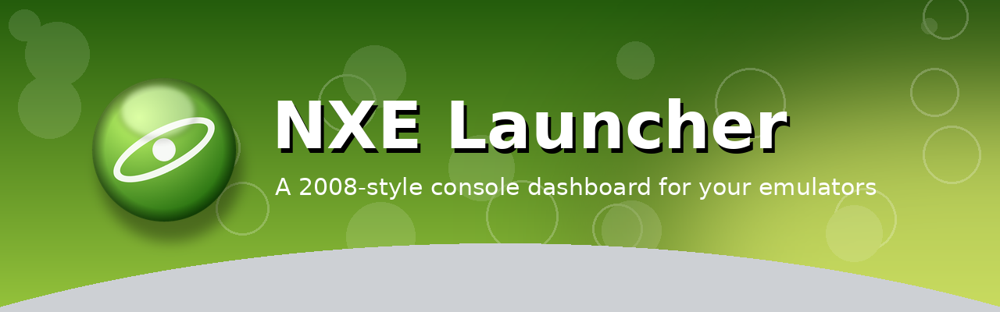
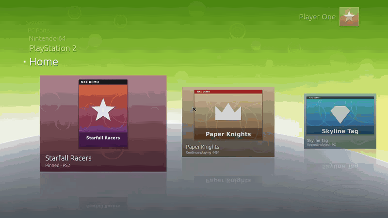
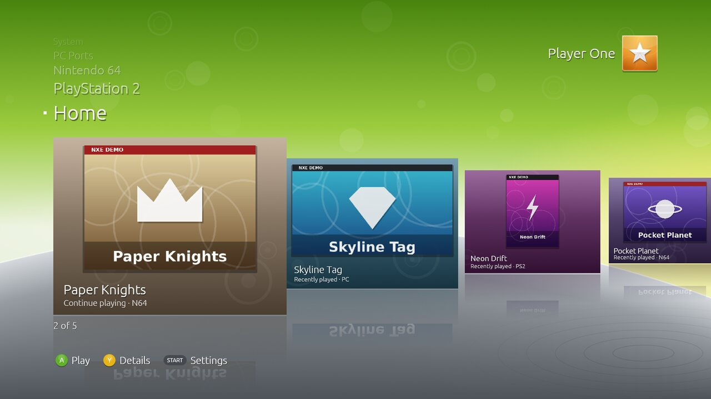
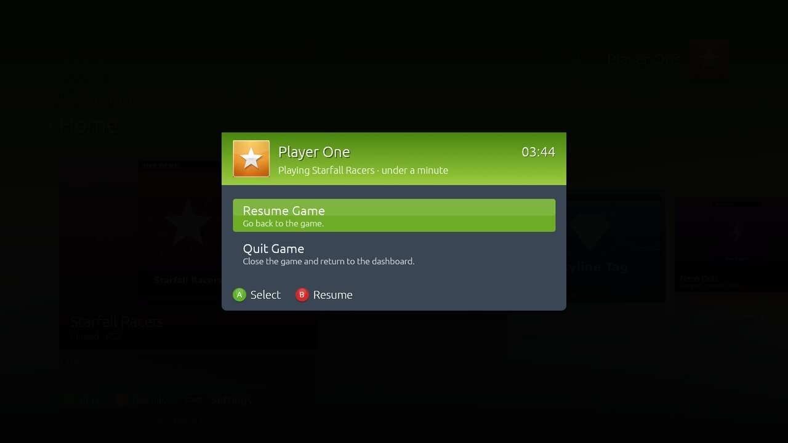
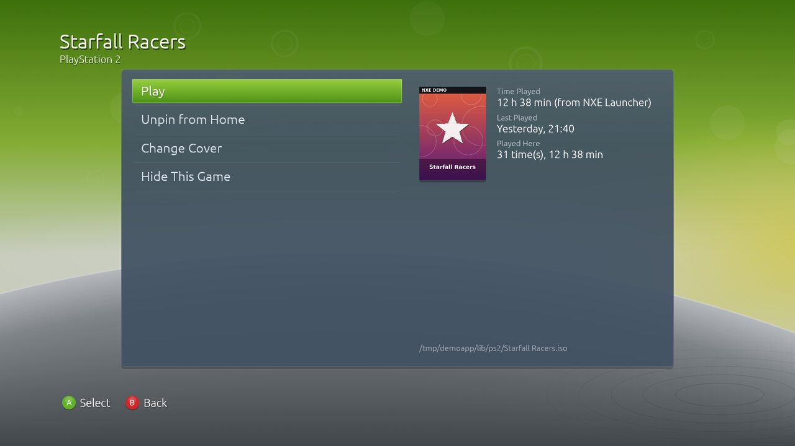
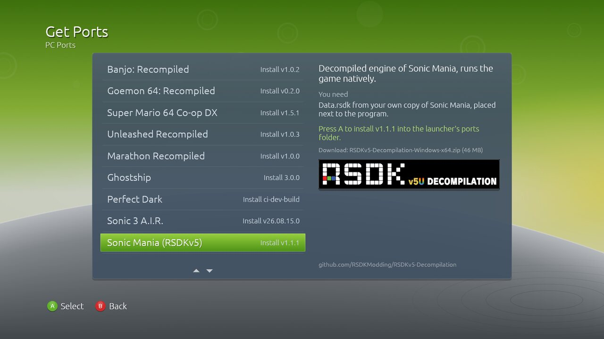
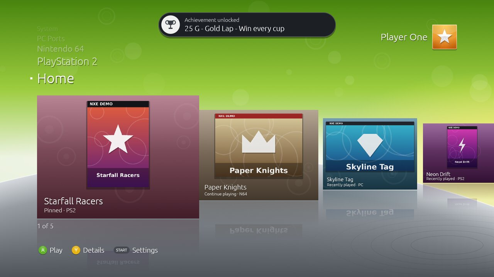
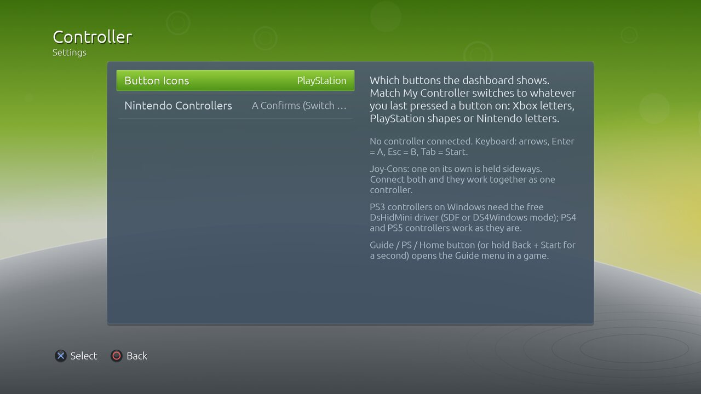
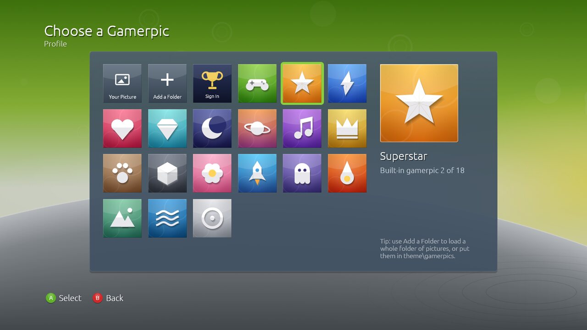
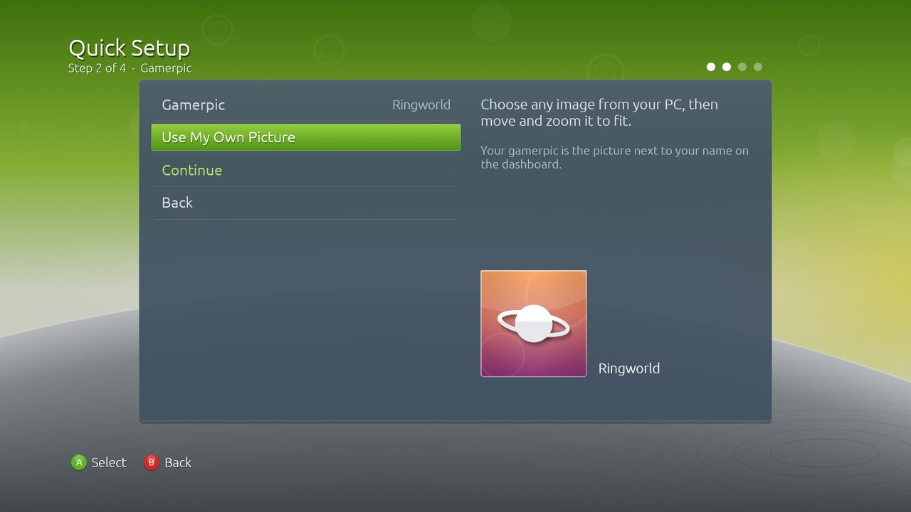

<p align="center">
  
</p>

<p align="center">
  <a href="https://github.com/cinarsavas/nxe-launcher/releases/latest"></a>
  
  
  
</p>

<p align="center">
  <b>A fullscreen, controller-first dashboard in the style of the 2008 "NXE" console dashboard.</b><br>
  Pick a game and it opens in the right emulator. Close it and you're back on the dashboard.<br>
  11 consoles · native PC ports · built-in cores · RetroAchievements · play time from your emulators
</p>

<p align="center">
  <a href="https://github.com/cinarsavas/nxe-launcher/releases/latest"><b>⬇️ Download the installer</b></a>
  &nbsp;·&nbsp;
  <a href="https://cinarsavas.github.io/nxe-launcher/"><b>🎮 Try it in your browser</b></a>
  &nbsp;·&nbsp;
  <a href="#-getting-started"><b>🚀 Getting started</b></a>
</p>

<p align="center">
  
</p>

> [!NOTE]
> Fan project, not affiliated with or endorsed by Microsoft, Sony or Nintendo. No games, BIOS files, keys or official artwork are included: you bring your own legally dumped games. The games and covers in these screenshots are made up.

---

## ✨ Highlights

<table>
  <tr>
    <td width="50%" valign="top">
      
      <h3>🕹️ One dashboard, every console</h3>
      Xbox 360, Xbox, PS3, PS2, PS1, PSP, Switch, GameCube, N64, DS and 3DS each get a channel, plus <b>PC Ports</b> for native recompilations. Smooth spring animations at your monitor's refresh rate, five colour themes, your own background music.
    </td>
    <td width="50%" valign="top">
      
      <h3>⏯️ Guide menu in-game</h3>
      Press <b>Guide / PS / Home</b> (or hold Back + Start) while playing: <b>Resume</b>, <b>Achievements</b> or <b>Quit</b> (with a "press A again" so progress isn't lost by accident).
    </td>
  </tr>
  <tr>
    <td width="50%" valign="top">
      
      <h3>⏱️ Play time, from everywhere</h3>
      Press <b>Y</b> on a game: time played, last played, pin to Home, hide, change cover, pictures. Play time includes what <b>PCSX2, DuckStation, RPCS3, Dolphin, PPSSPP</b> and the <b>Switch emulators</b> recorded before you ever used NXE Launcher.
    </td>
    <td width="50%" valign="top">
      
      <h3>📦 Get Ports</h3>
      Install and update PC ports straight from their GitHub releases: Zelda 64: Recompiled, Ship of Harkinian, Starship, Unleashed Recompiled, Sonic 3 A.I.R., Perfect Dark and more. You bring your own game files; each entry says which.
    </td>
  </tr>
  <tr>
    <td width="50%" valign="top">
      
      <h3>🏆 RetroAchievements</h3>
      Sign in once with your normal username and password. Points under your name, progress bars on games, achievement lists, <b>"Achievement unlocked" pop-ups</b> after you play, and one button that signs PCSX2, Dolphin and PPSSPP in too.
    </td>
    <td width="50%" valign="top">
      
      <h3>🎮 Any controller</h3>
      Xbox, PlayStation 3/4/5, Switch Pro and Joy-Cons (alone or as a pair). Button icons switch to <b>Xbox letters, PlayStation shapes or Nintendo letters</b> to match the controller in your hands.
    </td>
  </tr>
  <tr>
    <td width="50%" valign="top">
      
      <h3>🖼️ Gamerpics</h3>
      18 built-in gamerpics, whole folders of your own pictures, your RetroAchievements picture, or any image cropped to fit, all with the glossy 360-style finish.
    </td>
    <td width="50%" valign="top">
      
      <h3>💾 Your profile travels with you</h3>
      Name, gamerpic, play time and pins live in <code>Documents\NXE Launcher</code>. Reinstall, and Quick Setup says <b>Welcome back</b> and restores everything.
    </td>
  </tr>
</table>

**Also:** automatic cover art · optional built-in cores when you have no emulator · emulator graphics settings from the dashboard · Discord status · one-press updates · PS4-style page zoom.

---

## 🚀 Getting started

1. **Download** `NXE-Launcher-Setup-vX.exe` from the [latest release](https://github.com/cinarsavas/nxe-launcher/releases/latest) and run it.
   - It installs just for you (no administrator rights), adds NXE Launcher to the **Start menu and Windows search**, can add a desktop shortcut, and shows up in Settings → Apps for uninstalling.
   - If Windows says *"Windows protected your PC"*, click **More info → Run anyway** (the files aren't code-signed).
   - Prefer no installer? Grab `NXE-Launcher-vX-windows-x64.zip`, unzip it anywhere and run `nxe-launcher.exe`.
2. **Quick Setup** opens the first time: your name and theme, your gamerpic, your emulators (found automatically if they're next to the launcher), and cover art.
3. **Add your games** in Settings (**Start** / Tab) → Consoles → pick a console → **Add Game Folder**. Many emulators' own game lists are imported automatically.
4. Pick a game and press **A**. Press **Guide** in-game for the Guide menu.

### Controls

| Controller | Keyboard | What it does |
|---|---|---|
| D-pad / left stick | Arrow keys | Up / Down: channels · Left / Right: games |
| A | Enter | Play / select |
| B | Esc | Back |
| X | X | Achievements |
| Y | C | Game details |
| Start | Tab | Settings |
| Guide / PS / Home, or hold Back + Start | Home | In a game: the Guide menu |
| LB / RB | Q / E | Zoom (picture crop), next picture |
| | F11 | Fullscreen on / off |

---

## 🎮 Consoles

| Console | Emulators | Built-in core | Games |
|---|---|:---:|---|
| Xbox 360 | Xenia (Canary / Edge) | experimental | `.iso`, `.zar`, `default.xex`, GOD / Arcade packages |
| Xbox | xemu | experimental | `.iso` (XISO) |
| PlayStation 3 | RPCS3 | experimental | disc folders, installed games, `.iso` |
| PlayStation 2 | PCSX2 | ✓ (your BIOS) | `.iso`, `.chd`, `.cso`, `.zso`, `.gz`, `.cue` |
| PlayStation | DuckStation | ✓ (your BIOS) | `.cue`, `.chd`, `.pbp`, `.m3u`, `.iso` |
| PSP | PPSSPP | ✓ | `.iso`, `.cso`, `.chd`, `.pbp` |
| Switch | Eden, Citron, Sudachi, yuzu, Ryujinx / Ryubing | | `.nsp`, `.xci`, `.nsz`, `.xcz` |
| GameCube | Dolphin | ✓ | `.iso`, `.rvz`, `.gcz`, `.gcm`, `.ciso`, `.wbfs` |
| Nintendo 64 | RMG, simple64, Project64 | ✓ | `.z64`, `.n64`, `.v64`, `.zip` |
| Nintendo DS | melonDS | ✓ | `.nds` |
| Nintendo 3DS | Azahar, Lime3DS, Citra | ✓ | `.3ds`, `.cci`, `.cxi`, `.3dsx` (decrypted) |
| **PC Ports** | none needed | | native ports & recompilations |

---

## 📖 Full guide

<details>
<summary><b>Built-in cores (no emulator needed)</b></summary>

If a console has no emulator, NXE Launcher can use a libretro core instead. Cores are **optional and never downloaded unless you ask**: starting a game for a console with no emulator offers to download its core or to choose an emulator. You can also get a core under Settings → Consoles → [console] → Built-in Core. The first core also downloads a menu-less RetroArch player (about 58 MB, once for all consoles). Everything is stored in `runtime\` next to the launcher.

The player runs fullscreen with no menus and quits when the game closes, so it feels like a standalone emulator. L3 + R3 opens the core's own menu if you ever need it. **Play With** switches between Auto (your emulator; the core only if you downloaded it and have no emulator), Emulator and Built-in Core. PS1 and PS2 need your own BIOS in `runtime\system`.
</details>

<details>
<summary><b>Setting up emulators and games</b></summary>

Put each emulator in its own folder next to the launcher and it's found automatically:
```
NXE Launcher\
  nxe-launcher.exe
  xenia\xenia_canary.exe
  rpcs3\rpcs3.exe
  pcsx2\pcsx2-qt.exe
  eden\eden.exe
```
Anywhere else: Settings → Consoles → [console] → **Emulator**, then pick the program or just its folder.

**You often don't need to add game folders.** NXE Launcher imports what each emulator already knows: RPCS3 (`dev_hdd0\game` and `games.yml`), PCSX2 (`PCSX2.ini` game list), Eden / Citron / yuzu (`qt-config.ini`), Ryujinx (`Config.json`), Dolphin (ISO paths). Xenia has no game list, so add a folder there.

Each console page also has **graphics options** (resolution, aspect ratio, VSync, fullscreen) written straight into PCSX2, Dolphin, DuckStation, PPSSPP, Xenia and xemu's own settings (the original file is backed up as `*.nxe-backup`), **Controls & More Settings** (opens the emulator itself), and **Launch Options**.
</details>

<details>
<summary><b>Going to a game and back</b></summary>

Pressing A plays a short zoom, starts the emulator straight into the game in fullscreen, and brings it to the front. To come back, quit the game normally or use the Guide menu → **Quit Game**: NXE Launcher first asks the emulator to close like clicking X (so it can save), and only forces it after 3 seconds. The dashboard fades back in on the game you launched, and it moves to the front of **Home** under "Continue playing".

Default launch options: Xenia `--fullscreen=true`, PCSX2 `-fullscreen -nogui -batch --`, RPCS3 `--no-gui --fullscreen`, yuzu family `-f -g`, Ryujinx `--fullscreen`, Dolphin `-b -C Dolphin.Display.Fullscreen=True -e`, PPSSPP `--fullscreen --escape-exit`, DuckStation `-fullscreen -batch --`, xemu `-full-screen -dvd_path`.
</details>

<details>
<summary><b>Play time: where it comes from</b></summary>

NXE Launcher times every game it starts. It also reads the play time the emulators keep themselves; whichever is higher is shown, with its source. Each format was checked against the emulator's source code:

| Emulator | File it reads | Matched by |
|---|---|---|
| PCSX2 | `inis\playtime.dat` | disc serial (read from the .iso / .bin) |
| DuckStation | `playtime.dat` in its data folder | disc serial |
| RPCS3 | `GuiConfigs\persistent_settings.dat` | title ID |
| Dolphin | `Config\TimePlayed.ini` | 6-character game ID |
| PPSSPP | `[PlayTime]` in `ppsspp.ini` | disc ID (from the .iso) |
| Eden / Citron / Sudachi / yuzu | `play_time\*.bin` | title ID |
| Ryujinx | `games\<title id>\gui\metadata.json` | title ID |

Compressed images (CHD, CSO) don't expose the serial, so only NXE Launcher's own time is shown for those. Xenia, xemu, melonDS, Azahar and RMG don't record play time.
</details>

<details>
<summary><b>PC Ports and Get Ports</b></summary>

- **Get More Ports** (end of the PC Ports channel) lists: Zelda 64: Recompiled, Ship of Harkinian, 2 Ship 2 Harkinian, Starship, Spaghetti Kart, Banjo: Recompiled, Goemon 64: Recompiled, SM64 Co-op DX, Ghostship, Perfect Dark, Sonic 3 A.I.R., Sonic Mania (RSDKv5), Sonic 1 & 2 (RSDKv4), Zelda 3, Unleashed Recompiled, Marathon Recompiled and Dusk. A downloads the latest Windows release into `ports\`; when there's a new version the row says **Update** (the port's own settings and saves are kept).
- **Add Port Folder** (Settings → Consoles → PC Ports): a port's folder, or a folder with several ports. The right .exe is picked for you; uninstallers, updaters and redistributables are skipped. **Add a Single Program** picks one .exe.
- **GitHub Launcher (optional):** point to `GithubLauncher.exe` (formerly N64RecompLauncher) and everything it installed shows up with the same names.
- Known ports get the original game's box art and pictures.
</details>

<details>
<summary><b>RetroAchievements</b></summary>

Sign in once in Settings → Achievements with your normal username and password. The password is never saved, only the session token.

- Your points under your name, a progress bar on every game with a set, and **X** for its achievement list (also from the Guide menu).
- **"Achievement unlocked" pop-ups:** achievements are unlocked by the emulator while you play. When you return, NXE Launcher asks RetroAchievements what's new since the game started and shows a pop-up for each.
- **Sign In My Emulators Too** signs PCSX2, Dolphin and PPSSPP in with the same account (it writes what each writes after its own login; close them first). DuckStation encrypts its sign-in with a key tied to your PC, so sign in there once yourself. Built-in cores are signed in automatically.
- Optionally use your RetroAchievements profile picture as your gamerpic.
</details>

<details>
<summary><b>Controllers</b></summary>

- Button icons follow the controller you last pressed a button on; Settings → Controller can lock one style.
- **Nintendo controllers** confirm with A (the right button) like a Switch; "bottom button confirms" is an option.
- **Joy-Cons:** one on its own is held sideways; connect both and they work as one upright controller.
- **PS3 controllers on Windows** need the free DsHidMini driver (SDF or DS4Windows mode). PS4 and PS5 controllers work as they are.
</details>

<details>
<summary><b>Gamerpics, cover art, themes and music</b></summary>

- **Gamerpics:** built-ins, `theme\gamerpics` (starts empty, put your pictures there), any folder you add with **Add a Folder**, your own picture with a move-and-zoom crop, or your RetroAchievements picture.
- **Cover art** downloads automatically: PS2 by disc serial, GameCube by disc ID, Switch by title ID (read from inside .nsp/.nsz files, or `[TitleID]` in the file name) or by name from the eShop list, PC games from Steam by name, recompiled ports from their own project art, everything else by name from libretro-thumbnails. Wrong cover? Y → Change Cover shows every option found (labelled by source), lets you search a different name, or use any picture file. Your picks go in `theme\covers\<console>\`.
- **Cover style:** Settings → Display → Cover Art on Tiles: *Fill Tile* (crops the art to the whole tile) or *Whole Cover*.
- **Themes:** Green, Blue, Orange, Purple, Black (Settings → Display), with a colour fade between them. `theme\background.png` and `theme\font.ttf` replace the background and font.
- **Music:** MP3, OGG, FLAC or WAV in `theme\music` play shuffled on the dashboard and fade out when a game starts.
- **Sounds:** `theme\sounds\move.wav`, `select.wav`, `back.wav`, `channel.wav`, `launch.wav`.
</details>

<details>
<summary><b>Your profile file</b></summary>

Name, gamerpic, theme, play time, pinned and hidden games are kept in `Documents\NXE Launcher\profile.json`, outside the launcher's folder, so they survive uninstalling or moving it. Quick Setup offers **Welcome Back! Restore My Profile** when it finds one. Settings → General can save a copy anywhere (USB stick, cloud folder) and load one. Your RetroAchievements password and token are never stored in it.
</details>

<details>
<summary><b>Discord status</b></summary>

Shows "Playing <game> · <console>" on your Discord profile while you play. One-time setup: at discord.com/developers/applications click **New Application**, name it *NXE Launcher*, and paste its **Application ID** into Settings → General → Discord Application ID. The Discord desktop app must be running.
</details>

<details>
<summary><b>Updates and uninstalling</b></summary>

NXE Launcher checks GitHub for a new version when it starts (Settings → General → Check for Updates). Nothing installs on its own: **Update to vX** downloads it, swaps the exe and restarts; settings, profile and games stay.

Uninstall from Settings → Apps. It asks whether to also delete settings, covers and downloaded cores/ports; your profile in Documents is always kept.
</details>

<details>
<summary><b>Settings file</b></summary>

Everything is set from the dashboard, but it's all saved in `nxe-launcher.toml` next to the program:
```toml
gamertag = "Player"
fullscreen = true

[systems.ps2]
emulator = ""            # empty = find it automatically
args = []                # empty = the defaults above
game_dirs = []
import_from_emulator = true
backend = "auto"         # auto, emulator or core
```
If the file can't be read, it's kept as `nxe-launcher.toml.broken-<date>` instead of being overwritten.
</details>

---

## 🛠️ Building

```
cargo build --release
```
On Windows, or cross-compile from Linux with `cargo build --release --target x86_64-pc-windows-gnu`. The installer is built with NSIS: `makensis /DVERSION=x.y.z /DSRC=<folder with the exe> installer/nxe-launcher.nsi`. Releases are built by GitHub Actions when a `v*` tag is pushed.

## 📄 License

MIT, see [LICENSE](LICENSE). All trademarks belong to their owners.
